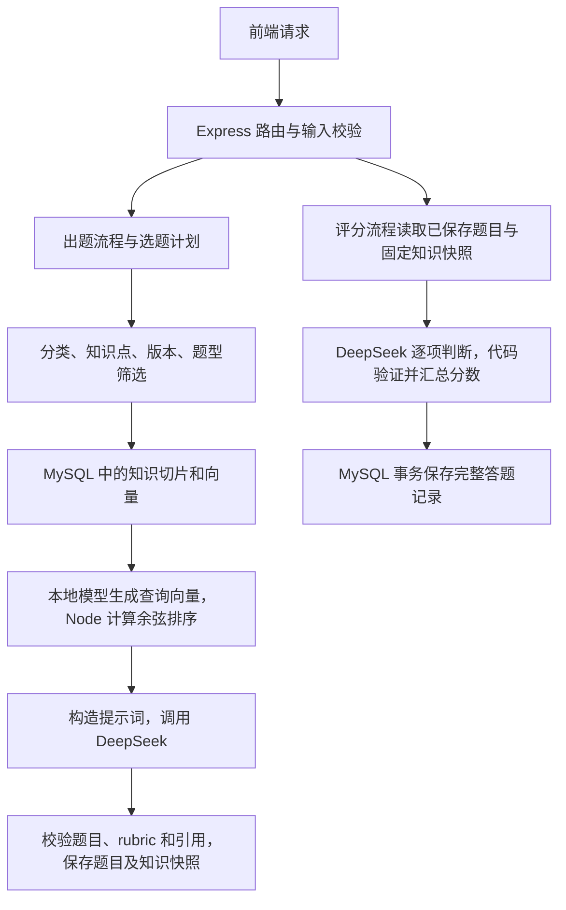

# AI前端面试助手：后端架构审阅

审阅日期：2026-10-12。以本地当前代码和 MySQL 数据为准。

## 判断

当前后端适合本地学习项目，分层合理，核心流程完整。建议保留整体架构，优先修正评分和知识导入的边界，再做少量整理。当前的主要不足是质量约束还有缺口，并不是缺少更多 AI 基础设施。

后端运行代码共 39 个 JavaScript 文件，约 2342 行非空代码；另有 7 个工具脚本、11 个测试文件。文件数量略多，但最长的运行模块约 208 行非空代码，尚未形成难以维护的大服务。不能把 165 份知识资料、测试和迁移工具的数量当成运行架构复杂度。

## 当前架构

这里没有独立的向量服务器。MySQL 的 `rag_documents` 保存资料，`rag_chunks` 保存切片及 JSON 向量。一个 Worker 线程加载本地中文向量模型；主线程负责 HTTP、业务流程与向量排序。DeepSeek 负责出题和评分，不负责 Embedding。

### 值得保留

| 模块 | 当前做法与评价 |
| --- | --- |
| 应用装配 | `app.js` 与 `server.js` 分开，方便注入测试数据、测试路由及关闭服务。 |
| 业务分层 | 路由处理请求，Flow 串联业务，Prompt 构造输入，Repository 操作数据库。当前无需新增 Controller/Manager/Factory 等层。 |
| 评分 | 模型给出逐项 verdict，后端按权重计算总分；可选追问不扣分。这是项目的重要优势。 |
| 固定评分依据 | 评分读取出题时的知识快照，不用用户回答重新检索并替换标准，避免知识更新或回答内容改变评分条件。 |
| 数据稳定性 | SQL 参数化、事务、分类锁、幂等提交、死锁有限重试、历史完整快照均有测试。 |
| 请求生命周期 | 输入在付费调用之前验证，AI 有截止时间，断开连接会取消上游请求，SSE 成功事件在题目保存后发送。 |
| 小型知识库 | Markdown 是可读、可版本控制的资料来源；两张知识表足够。 |
| 本地 Worker | 避免模型计算占用处理请求的主线程，模型可复用，也有队列限制和关闭逻辑。保留一个即可。 |
| 学习统计 | 从历史计算练习成绩和薄弱知识点，不再调用模型推断“能力分数”。样本量显示与无样本状态都值得保留。 |

Worker 的用途与 Node 官方对 CPU 密集任务的建议一致：[Node Worker 文档](https://nodejs.org/api/worker_threads.html)。不建议为了减少一个文件而把模型推理放回主线程。

## 已复现的问题

### 1. P1：评分证据校验会改变代码语义

位置：`backend/services/aiContract.js:51,72`。

`comparable()` 对回答和模型证据执行 NFKC 规范化，并删除全部空白，再判断包含关系。实际回答为 `return "ab"`，模型伪造的证据为 `return "a b"`，当前校验仍接受该证据，并允许得到 100 分。字符串中的空格有意义，不能这样忽略。此复现说明证据校验被绕过，不代表已经证明真实模型一定会这样评分。

建议：对证据使用原文连续片段校验，仅统一明确无语义差异的换行；保留字符串、模板字符串、Unicode 字符及空格。补充字符串空格、全角字符、转义字符和拼接证据的反例测试。先修此项，因为它影响评分可信度。

### 2. P2：题目正文查重也存在同类误判

位置：`backend/services/aiContract.js:49`、`backend/services/mysqlStore.js:47`。

当前 `contentKey('请输出 "a b"')` 与 `contentKey('请输出 "ab"')` 相同。不同的代码行为可能被误判为重复题，触发重新生成和额外模型调用。

建议：正文指纹保留内部空白及代码原文，只统一换行和整体首尾空白即可。修改时必须同步回填 MySQL 已有 `contentKey`，否则新旧指纹规则混用会漏查重复题。保留题目 ID、原文和历史快照，并先备份。标题去重可以继续保持较宽松规则，不应与代码正文共用规则。

### 3. P2：导入接受的切片可能无法向量化

位置：`backend/services/knowledge/chunker.js:4,27`、`backend/workers/localEmbedding.js:30`。

切片按字符数控制，通常合并到 1800 字符，单块最多允许 6000 字符；模型实际限制为 512 token。本次一段 960 字符的中文正文通过切片校验，调用真实本地模型时被拒绝。索引每次取前 4 条，只要这一批含有过长片段，就会反复失败，直到人工修正资料。

现有 165 份短资料均已完成向量化，此问题影响后续导入较长官网内容，而非说明当前索引损坏。

建议：在整批导入前增加真实 tokenizer 检查，计算 `passage: `、章节标题与正文的总 token 数，错误定位到文件和章节。先要求人工缩短完整知识单元，保留代码块；无需立即实现复杂自动切片。预检不通过时不要先写入部分资料。

### 4. P2：相似度阈值不能证明知识相关或充足

位置：`backend/services/knowledge/service.js:38`、`backend/scripts/check-rag.js`。

当前以余弦相似度 `>= 0.45` 作为命中条件。真实本地模型复现：

| 检索范围 | 查询 | 最高相似度 | 当前结果 |
| --- | --- | ---: | --- |
| Pinia | 状态解构后如何保留响应式 | 0.926 | grounded，合理 |
| Pinia | HTTP 的 no-cache 与 no-store | 0.856 | grounded，查询与资料不匹配 |
| Pinia | asdf qwerty zxcv 839294 | 0.777 | grounded，无意义输入也命中 |
| satisfies | HTTP 的 no-cache 与 no-store | 0.814 | grounded，查询与资料不匹配 |

这几项反例针对检索预览与检索服务的质量约束。正常出题查询固定使用已选知识点名称，且 SQL 已隔离分类、知识点、题型、版本，不能据此声称正常出题会直接混用 HTTP 与 Pinia。问题在于 `grounded` 目前仅表示选到了资料，不能证明资料回答了查询或支撑了全部评分要求。

该模型官方说明指出，其相似度数值通常偏高，主要用于比较排序；512 token 限制和 query/passage 前缀也有明确说明：[multilingual-e5-small 模型卡](https://huggingface.co/intfloat/multilingual-e5-small)。项目正确使用了前缀、均值池化和归一化，但拒绝不相关查询的规则缺少验证依据。

建议：保留知识点隔离，补充不相关查询、同知识点未覆盖子问题、错误版本、无资料等测试。基于这些样例决定阈值用途，先提供可诊断的命中分数及原因。不要直接把 0.45 改成一个更高的任意数字；也不要新增付费模型来判断每次检索。正常样例通过与可靠拒绝无关内容是两种不同的验证。

## 提示词与 AI 设计

### 做得好的地方

- 出题约束题干长度、单一考点、指定版本与难度，并要求题干与必要评分项一致，符合简短面试题的定位。
- 评分明确区别 met、partial、missed、incorrect；不由模型决定最终总分；不因缺少可选拓展扣分。
- 理论、场景、手写、排错分别构造规则，代码回答明确只做阅读分析，不声称已经运行。
- 输入以 JSON 数据提供，题目、资料和回答中的命令不应改变系统任务。
- JSON 输出、完成原因、字段长度、权重、引用 ID 都有后端校验，格式修复最多一次。

这些结构比继续堆叠提示词更重要。DeepSeek 的 JSON 模式仍可能遇到空内容或长度截断，保留校验与有限修复是合理的：[DeepSeek JSON 文档](https://api-docs.deepseek.com/guides/json_mode/)。

### 仍存在的质量限制

1. **资料绑定不等于事实验证。** `validateBindings()` 能证明切片 ID 存在，不能证明 rubric 的技术结论由该切片支持。题目、rubric 和参考答案仍来自同一次模型生成，三者可能一致地出错。优先为常练的 10–20 个知识点整理人工核对过的必要回答要点与评分反例，不必增加第二个“裁判 Agent”。知识元数据已经支持 `rubric_template`，无需为此增加表。
2. **难度是提示词约定。** easy/medium/hard 的机制描述清楚，但没有难度校准数据。使用几组固定题和人工认可答案验证即可，不应将不同题目分数宣传为客观岗位能力评估。
3. **知识覆盖不足以支撑所有分类全面 RAG。** 当前资料覆盖 131/468 个知识点，约 28%；未覆盖处会正常回退。实际 RAG 使用比例还取决于用户选择和选题策略，不能直接用 28% 推算请求命中率。优先补用户常练方向，不需马上补齐所有知识点。
4. **Prompt 数据可更精简。** 模型需要切片 ID、标题、版本、正文；文档 hash、修订号、索引指纹、检索时间等可留在服务端快照。构造一个简单的 Prompt 资料视图即可，避免每次把存储元数据全发给模型。不要删除持久化来源信息。
5. **格式修复与重复题重选可以分开。** 当前出题重试都会重新选计划、重新检索；格式错误可复用原计划和依据，重复题才需要重新选择内容。这会让行为更容易理解和测试。

## 向量方案与性能

真实测量使用独立审阅进程、本机已有模型缓存：首次查询约 1.48 秒，后续三个查询约 10–12 毫秒。进程 RSS 从约 67 MiB 增至 551 MiB，其中包含模型和运行时。一次测量不是性能基准，也不能据此认定内存泄漏；正式后台进程的占用未在此测量。

当前每个知识点只有少数短卡，标签筛选承担了主要定位作用，向量更多是在这个小范围内排序。165 条向量规模下，MySQL 保存 JSON、Node 计算余弦足够。当前更有价值的是资料内容与检索验证，不是换向量数据库。

建议维持一个可复用 Worker，先记录加载与检索耗时。暂时不加模型池、独立向量 HTTP 服务、Redis、Qdrant 或 Docker。以后在同一知识点切片显著增加、实测查询变慢时，再先考虑 SQL 的分类/版本索引和紧凑的向量读取。现有容量保护是单一知识点最多 1000 个候选，不是全知识库最多 1000 条。

如果学习阶段更重视理解，也可以讨论“单一资料直接按标签取，多个资料再向量排序”的简化，但它会改变检索方式，需要明确标识标签命中，不能继续统一称为 semantic。本次不建议马上加入此分支，现有模型已能稳定运行。

## 可以简化与小幅优化

| 项目 | 建议 | 顺序 |
| --- | --- | --- |
| 两套知识来源 | `backend/data/knowledge.js` 的普通事实卡与 Markdown 知识内容重复。逐步以 Markdown 为主；保留旧基准题的专用 rubric 兼容，补测试后再删除普通事实分支。 | 修复评分后 |
| 知识操作脚本 | 日常集中在下载、导入/预检、索引、状态几个入口，抽出 setup 与 knowledge 脚本重复的导入索引循环；旧迁移入口放在迁移文档，运行时不加载。 | 后续整理 |
| 配置残留 | `configured: true` 当前未使用；`provider` 固定，指纹中的空 baseUrl 是旧结构残留。可减少对外配置字段，但不能随意改指纹序列化，否则会让现有向量全部过期。 | 低优先级 |
| 失败信息 | 检索异常被统一回退，模型线程把多数异常都称为加载失败，AI 路由与数据库错误缺少原因记录。补少量结构化日志：阶段、耗时、错误码、回退原因和尝试次数；避免记录密钥与完整回答。 | 建议优化 |
| 评分保存后重试 | 已保存提交重试不重新评分，但落库失败后用户再次提交会重新调用模型。本次模拟两个客户端请求，第一次保存失败、第二次恢复，合计调用两次。现有测试只保证单个请求内不重做。 | 成本优化 |
| 健康检查 | `/api/health` 复用了 summary，会统计三张表并读取收藏列表。可改轻量数据库探测；当前测得约 7 毫秒，暂不构成瓶颈。 | 低优先级 |
| 历史快照 | 评分结果和 questionSnapshot 都包含知识快照，持久化有重复。但直接删字段会影响导出导入、评分校验与旧记录读取；目前短卡规模下先保留。 | 暂缓 |
| 文件风格 | 个别 Prompt、计划、学习 SQL 模块较密集，统一格式、增加少量业务规则注释，比继续新增层级更能帮助学习。 | 后续整理 |

落库失败后的成本优化可先明确提示“再次提交会重新评分”。如果实际经常发生，再考虑有数量和时间上限的短期结果缓存，仅重试保存；进程退出后仍不能保证不重复调用。无需现在设计分布式任务或跨进程幂等账本。

另外，同一提交的并发请求共用首次请求的 Promise 和取消信号；首次调用取消可能让跟随请求一起失败。这是当前并发任务的边界，已有测试覆盖正常并发，没有覆盖这个取消组合。若要调整，应先补针对性测试，当前单用户页面不用因此引入复杂任务协调器。

## 推荐执行顺序

1. **先处理正确性：** 修复原文证据校验和代码正文指纹；备份并回填已有指纹；补能复现两种误判的测试。保留现有 rubric、历史和题干长度。
2. **再处理知识边界：** 整批 tokenizer 预检、定位超长资料；补检索反例与引用支持样例；逐步补常练知识点。先建立判断依据，再调参数。
3. **最后做轻量整理：** 精简 Prompt 的资料视图，统一知识来源和脚本循环，增加必要日志。健康检查、取消组合、保存失败成本按实际需要处理。

## 本次验证与范围

- 后端测试 76/76 通过，包含真实临时 MySQL 数据库；AI 响应使用测试数据。
- 真实本地模型和临时知识库：165 份文档、165 个向量全部完成，11 个正常检索样例通过。
- 额外复现评分证据、正文查重、保存失败后的再次调用、4 个检索查询和长中文片段向量化边界。
- 前端入口、后端健康检查、知识状态均返回 HTTP 200；当前知识索引 0 pending。
- 对正式库的 questions、favorites、history、review_marks、rag_documents、rag_chunks 前后取内容指纹，确认这些数据未改变。
- 本次没有新增付费模型调用，也没有做大样本评分准确率、并发负载或依赖漏洞审计。因此“测试通过”不代表“技术事实、难度与评分已全面认证”。

复现脚本与原始 JSON 保存于忽略目录 `backend/.cache/backend-review-probes.cjs`、`backend/.cache/backend-review-probes.json`。本次只新增审阅记录与本地复现材料，没有修改应用实现。
